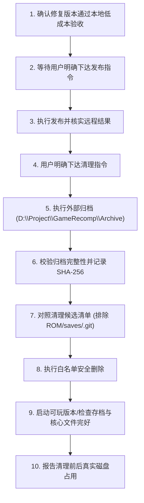

# MarioLuigiSuperstarSagaRecomp — 本地工程体积专项审计与归档清理规范

> **审计生成日期**：2026-10-14  
> **审计状态**：只读审计与方案制定（本阶段不执行任何破坏性删除操作）  
> **项目根目录**：`D:\Project\GameRecomp\MarioLuigiSuperstarSagaRecomp`  
> **建议外部归档目标**：`D:\Project\GameRecomp\Archive\`

---

## 一、当前工程全景数据统计

| 统计指标 | 实测数值 | 备注 |
|---|---|---|
| **工程总磁盘占用** | **480.06 MB**（503,377,879 字节） | 包含未提交的 ROM、生成代码与编译产物 |
| **总文件数量** | **2,171** 个文件 | |
| **总目录数量** | **690** 个文件夹 | 含 Git 子模块与依赖树内部结构 |
| **超过 100 MB 的单文件** | **0 个** | 最大单文件为编译产物 EXE（约 41.8 MB） |
| **超过 100 MB 的一级目录** | **2 个** | `generated/`（184.39 MB）、`build/`（121.26 MB） |

---

## 二、一级目录与关键子树体积详细分解

| 目录 / 路径 | 当前体积 | 文件数 | 用途说明 | 是否可重新生成 | 保留决策 | 预计可回收空间 |
|---|---:|---:|---|:---:|:---:|---:|
| **`generated/`** | 184.39 MB | 17 | 卡带与 BIOS 重编译 C++ 源码分片（8 个 shard）及分发表 | 是（依赖 ROM/BIOS 运行 `regen.ps1`） | **本地必须保留**（发布前避免重复耗时全量重扫；清理时先归档） | 184.39 MB（仅限深度归档模式） |
| **`build/host/`** | 121.26 MB | 189 | CMake/Ninja 构建产物，包含当前可玩 EXE、DLL、obj 目标文件与缓存 | 是（运行 `build-host.ps1` 可重建） | **部分保留**（保留可玩 EXE 及 DLL，中间 obj 可清理） | 70.00 MB ~ 121.26 MB |
| **`release-stage/`** | 67.05 MB | 44 | 发布候选包（解压中间目录 47.9 MB + 压缩包 19.1 MB） | 是（运行 `make-release.ps1` 可重建） | **保留压缩包与哈希**，解压目录可清理 | 47.90 MB |
| **`.deps/`** | 31.28 MB | 236 | toml++ 固定版本库及浅克隆 Git 历史 | 是（运行 `setup-deps.ps1` 可拉取） | **日常保留**（深度冷藏时可删） | 31.28 MB（深度冷藏模式） |
| **`.git/`** | 30.87 MB | 264 | Git 版本库核心数据库与提交历史 | 否 | **严禁删除** | 0 MB |
| **根目录 ROM** | 16.00 MB | 1 | 本地测试用合法美版 GBA ROM 原件 | 否 | **严禁删除**（私有关键资产） | 0 MB |
| **`recomp-ui/`** | 14.98 MB | 210 | Git Submodule（GUI 启动器子模块） | 是（Git Submodule 初始化） | **日常保留** | 0 MB |
| **`gbarecomp/`** | 7.02 MB | 574 | Git Submodule（重编译框架核心） | 是（Git Submodule 初始化） | **日常保留** | 0 MB |
| **`reference/`** | 6.94 MB | 570 | 历史克隆的旧版 gbarecomp 框架副本（已由子模块取代） | 是（完全冗余副本） | **建议清理** | 6.94 MB |
| **`tools/`** | 0.08 MB | 37 | 构建、回归验证与发布自动化脚本 | 否（受 Git 跟踪） | **严禁删除** | 0 MB |
| **`docs/`** | 0.04 MB | 9 | 版本 Pin、规范审计与许可证文件 | 否（受 Git 跟踪） | **严禁删除** | 0 MB |
| **`logs/`** | 0.03 MB | 4 | 生成与构建日志文件 | 是（运行自动刷新） | **建议清理** | 0.03 MB |
| **`saves/`** | 0.01 MB | 1 | 8 KiB EEPROM 原始卡带存档（`mlss_usa.sav`） | 否 | **严禁删除**（游戏核心进度） | 0 MB |
| **`src/`** | < 0.01 MB | 2 | 宿主入口点与启动器适配代码 | 否（受 Git 跟踪） | **严禁删除** | 0 MB |
| **`tests/`** | < 0.01 MB | 1 | 启动器契约回归测试源码 | 否（受 Git 跟踪） | **严禁删除** | 0 MB |

---

## 三、资产属性分级与保护准则

所有工程内数据必须严格划分层级，绝不采用无差别或全盘重置策略：

* **Category A（Git 跟踪的核心资产）**：
  * 文件：`CMakeLists.txt`, `README.md`, `README.zh-CN.md`, `THIRD_PARTY_NOTICES.md`, `LICENSE`, `game.toml`, `src/`, `tests/`, `tools/`, `docs/`, `.gitmodules`。
  * 准则：**永久受版本控制保护**，工作区变动须经 Git 审计。
* **Category B（本地运行必需私有数据）**：
  * 文件：`Mario Luigi - Superstar Saga (USA).gba`、`saves/mlss_usa.sav`、`generated/cart/` 与 `generated/bios/`。
  * 准则：**禁止自动删除**。虽然 `generated/` 理论上可通过 ROM 重新扫描生成，但全量扫描和切片耗费计算资源与时间，且关乎可复现性；若需删除必须先归档外部。
* **Category C（当前可玩原生程序）**：
  * 文件：`build/host/MarioLuigiSuperstarSagaRecomp.exe`、`SDL2.dll`、MinGW 运行库 DLL、`assets/`。
  * 准则：在未获得新一轮验证通过的构建前，保留当前可执行版本，便于即时验证。
* **Category D（发布候选归档）**：
  * 文件：`release-stage/MarioLuigiSuperstarSagaRecomp-windows-x64-v0.1.0-preview.zip` 与对应 `.sha256`。
  * 准则：ZIP 与哈希属于交付产物；同目录下的展开文件夹（47.9 MB）可即时清理。
* **Category E（完全可再生的缓存与重复副本）**：
  * 文件：`reference/gbarecomp`（完全被子模块取代的重复框架副本）、`build/host/CMakeFiles/`（中间 obj 目标文件）、`build/host/libgame_launcher_ui.a`、旧日志。
  * 准则：**首选清理目标**。

---

## 四、分层清理方案与预计回收空间

### 方案 1：无损轻量瘦身（Lightweight Cleanup）
* **操作内容**：
  1. 删除重复框架副本 `reference/`（节省 6.94 MB）；
  2. 删除 `release-stage/` 中已打成 ZIP 的展开中间目录（节省 47.90 MB）；
  3. 清理 `logs/` 下的历史构建日志与历史 coverage 碎片（节省 0.04 MB）。
* **预计回收空间**：**~54.88 MB**
* **特点**：零编译成本，保留所有生成代码和当前可玩 EXE，下次启动或测试立即可用。

### 方案 2：构建缓存清理（Build Intermediate Cleanup）
* **操作内容**：
  1. 包含方案 1 的所有步骤（54.88 MB）；
  2. 清理 `build/host/CMakeFiles/` 下的所有 `.cpp.obj` 编译中间件（节省约 70 MB）。
* **预计回收空间**：**~124.88 MB**
* **特点**：保留生成的 C++ 源码、当前可玩 EXE 与发布 ZIP，仅清理 Ninja/GCC 的中间构建文件。

### 方案 3：项目外全量归档后深度冷藏（Full Deep Cold Storage）
* **操作内容**：
  1. 将整个工程（包含 `generated/`、`build/host/` EXE、`saves/`、ROM）压缩归档至 `D:\Project\GameRecomp\Archive/MarioLuigiSuperstarSagaRecomp_prepub_<date>.7z`；
  2. 验证归档校验和通过后，清理 `build/`（121.26 MB）、`generated/`（184.39 MB）、`release-stage/`（67.05 MB）、`reference/`（6.94 MB）、`.deps/`（31.28 MB）；
  3. 工程仅保留 Git 跟踪代码、Submodules、ROM 与 Saves。
* **预计回收空间**：**~390 MB**
* **工程最终驻留体积**：从 **480 MB** 骤降至 **~38 MB**（节省 81% 空间）。

---

## 五、发布后清理执行标准流程（10-Step Safe Procedure）

待用户正式下达发布并批准清理指令后，严格执行以下 10 步流程：

1. **验收核对**：确认文档、许可证与打包资源全部通过审查；
2. **发布授权**：等待用户明确许可发布；
3. **远端核验**：确认 GitHub Release、Tag 与资产就绪；
4. **清理授权**：用户明确触发工程瘦身；
5. **外部归档**：使用本地 7-Zip（`C:\MYAPPLY\7-Zip\7z.exe`）将关键非 Git 资产备份至 `D:\Project\GameRecomp\Archive/`；
6. **校验固化**：计算归档包 SHA-256，验证可解压性；
7. **清单核验**：严禁使用 `git clean -fdx`，只按白名单路径定位目标；
8. **安全清理**：移除 `reference/`、`release-stage/` 解压目录与中间 `.obj`；
9. **复原验证**：验证 `MarioLuigiSuperstarSagaRecomp.exe`、ROM 与 `saves/mlss_usa.sav` 完好无损；
10. **汇报成效**：统计并上报真实释放的磁盘字节数。
